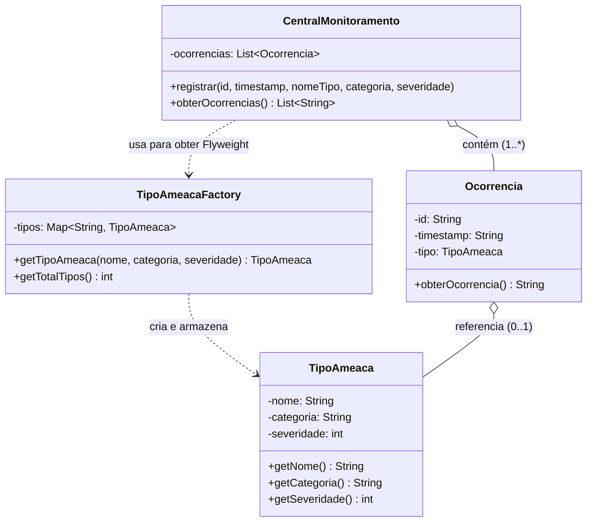

# Padrão Flyweight - Monitoramento de Ameaças de Segurança

[](https://openjdk.java.net/)
[](https://junit.org/junit5/)

Implementação do padrão de projeto **Flyweight** (Estrutural) em Java. O projeto demonstra como usar o compartilhamento para suportar um grande número de objetos de granularidade fina de maneira eficiente, separando o estado intrínseco (compartilhado) do estado extrínseco (contextual).

---

## Descrição e Intenção

**Definição (GoF):** Usar o compartilhamento para suportar eficientemente um grande número de objetos de granularidade fina.

### O Problema (Estouro de Memória)
Em um sistema de monitoramento de segurança (SOC), milhares de ocorrências de ameaças são registradas por minuto. Muitas dessas ocorrências compartilham os mesmos tipos de ameaça (ex: "SQL Injection", "DDoS"). Se cada ocorrência instanciar um novo objeto `TipoAmeaca` com seus dados (nome, categoria, severidade), o consumo de memória se torna proibitivo e a pressão no Garbage Collector (GC) aumenta drasticamente.

### A Solução
O padrão Flyweight separa os dados em dois estados:
1. **Estado Intrínseco:** Informações imutáveis e compartilháveis (ex: nome e severidade do tipo de ameaça). São armazenadas em um cache (Factory).
2. **Estado Extrínseco:** Informações únicas de cada evento (ex: ID da ocorrência, timestamp). São passadas pelo cliente no momento do uso.

---

## Estrutura do Projeto

```text
src/
├── main/
│   └── java/padroesestruturais/flyweight/
│       ├── TipoAmeaca.java               (Flyweight Concreto: Estado Intrínseco)
│       ├── TipoAmeacaFactory.java        (Flyweight Factory: Cache de compartilhamento)
│       ├── Ocorrencia.java               (Contexto: Estado Extrínseco + Referência ao Flyweight)
│       └── CentralMonitoramento.java     (Cliente)
│
└── test/
    └── java/padroesestruturais/flyweight/
        └── CentralMonitoramentoTest.java (Casos de teste)
```

## Diagrama de Classes
O diagrama abaixo ilustra a relação-chave: a Factory mantém um cache de instâncias únicas de `TipoAmeaca`. O contexto (`Ocorrencia`) armazena apenas uma referência a essa instância compartilhada, enquanto o cliente (`CentralMonitoramento`) orquestra a criação.



### Análise Crítica: Vantagens e Pontos Cegos

É fundamental diferenciar os benefícios teóricos dos riscos práticos de implementação.

#### Vantagens (Fatos)
* **Economia Massiva de Memória:** Se houver 10.000 ocorrências de apenas 50 tipos de ameaças, o sistema cria apenas 50 objetos `TipoAmeaca`, em vez de 10.000.
* **Desempenho:** Menos alocação de objetos significa menos pausas do Garbage Collector, crucial para sistemas de monitoramento em tempo real.
* **Imutabilidade Inerente:** O estado intrínseco do Flyweight deve ser imutável (sem setters), o que naturalmente previne efeitos colaterais inesperados.

#### Pontos Cegos e Contrapontos (Onde o padrão exige cuidado)
1. **Risco de Mutabilidade (Violação Silenciosa):**
   * **Fato:** Se um desenvolvedor adicionar um setter (ex: `setSeveridade`) na classe `TipoAmeaca` no futuro, alterar esse valor afetará **todas** as ocorrências que compartilham aquele tipo.
   * **Contraponto:** A classe `TipoAmeaca` deve ser estritamente imutável (apenas getters). Esta implementação segue essa boa prática.
     
2. **Thread Safety na Factory (Ponto Cego desta Implementação):**
   * **Fato:** A `TipoAmeacaFactory` utiliza um `HashMap` simples (`new HashMap<>()`), que não é thread-safe.
   * **Contraponto (Visão Profissional):** Em um ambiente concorrente real (ex: múltiplos threads registrando ameaças simultaneamente), isso pode causar *race conditions* e corromper o cache. A solução profissional seria utilizar `ConcurrentHashMap` e o método `computeIfAbsent()`. O `HashMap` foi mantido aqui para espelhar a simplicidade didática do material de referência.
     
3. **Complexidade Cognitiva:**
   * **Fato:** Separar estado intrínseco e extrínseco torna o código mais complexo de entender.
   * **Contraponto:** O padrão só deve ser aplicado quando o volume de objetos justifica a otimização. Para poucos objetos, a complexidade adicionada não compensa.

---

### Diferença Crucial: Flyweight vs. Singleton

Esta é uma confusão muito comum, pois ambos envolvem o "compartilhamento de instâncias".

| Característica | Padrão Flyweight | Padrão Singleton |
| :--- | :--- | :--- |
| **Intenção** | Compartilhar **múltiplas instâncias** com estado intrínseco idêntico para economizar memória. | Garantir que exista **apenas uma única instância** de uma classe em toda a aplicação. |
| **Quantidade de Objetos** | Pode haver várias instâncias do Flyweight (ex: 50 tipos de ameaça), mas cada uma é compartilhada por muitos contextos. | Existe estritamente **1** objeto global (ex: 1 única conexão com o banco de dados). |
| **Estado** | Possui estado intrínseco (imutável) e recebe estado extrínseco do contexto. | Geralmente gerencia estado global ou recursos compartilhados da aplicação. |
| **Exemplo** | Várias ocorrências compartilhando o mesmo objeto `TipoAmeaca("DDoS")`. | Uma única instância da classe `ConfiguracaoDeSeguranca`. |

---

### Testes

O projeto contém testes unitários (JUnit 5) que validam:
* A `CentralMonitoramento` gera a saída formatada correta, combinando estado extrínseco e intrínseco.
* A `TipoAmeacaFactory` reutiliza as instâncias: ao registrar 4 ocorrências de apenas 2 tipos de ameaça, o método `getTotalTipos()` retorna corretamente **2**, provando a economia de memória.

---

### Tecnologias Utilizadas

| Tecnologia | Versão | Finalidade no Projeto |
| :--- | :--- | :--- |
| **Java** | 21 | Linguagem de programação principal |
| **Maven** | 3.9+ | Gerenciamento de dependências e automação de build |
| **JUnit 5** | 5.9.x | Framework para execução dos testes unitários |
| **Draw.io / Mermaid** | Web | Criação e renderização dos diagramas UML |
